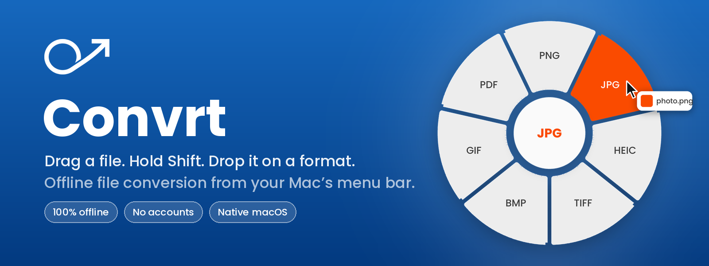
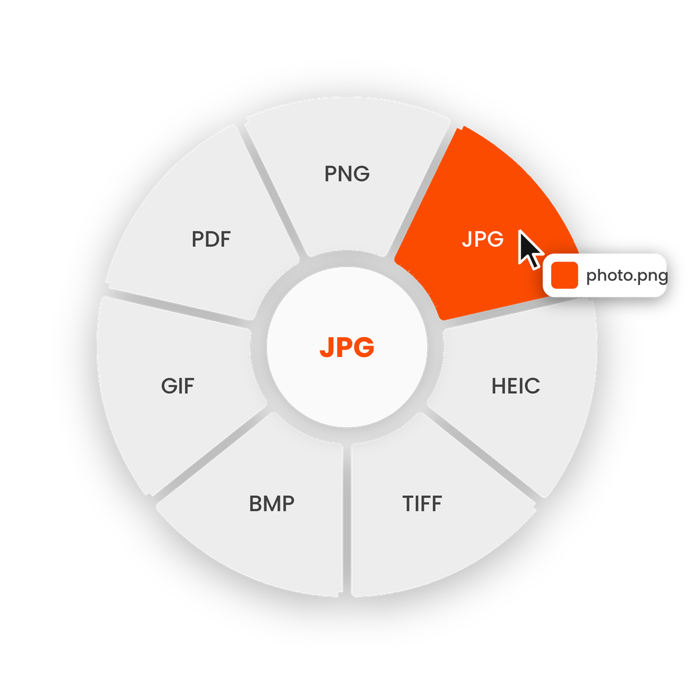

<div align="center">

<picture>
  <source media="(prefers-color-scheme: dark)" srcset="assets/logo-white.png">
  
</picture>

# Convrt

**Drag a file. Hold Shift. Drop it on a format.**
A tiny, fully offline file converter that lives in your Mac's menu bar.

[](#requirements)
[](#how-it-works)
[](#privacy)
[](#roadmap)
[](LICENSE)



</div>

---

## Contents

[What it is](#what-it-is) · [Features](#features) · [How it works](#how-it-works) · [What it converts](#what-it-converts) · [Install](#install) · [Permissions](#permissions) · [Settings](#settings) · [Privacy](#privacy) · [Project layout](#project-layout) · [Roadmap](#roadmap) · [Shipping a release](#shipping-a-release) · [Contributing](#contributing) · [License](#license)

## What it is

Convrt sits quietly in the menu bar with no Dock icon. Start dragging files from anywhere (Finder, the Desktop, any folder),
**hold Shift**, and a radial wheel of formats appears right at your cursor. Drop the files on a wedge and the converted
copies land next to the originals. Nothing is ever overwritten, nothing leaves your Mac.

<div align="center">
  
</div>

## Features

| | |
|---|---|
| **Drag, hold Shift, drop** | The wheel appears at your cursor while you drag. Release Shift or press Esc and it fades away. |
| **Only sensible formats** | The wheel shows just the formats that make sense for what you're dragging. Mixed selections show only formats valid for every file. |
| **Never overwrites** | `photo.jpg` already exists? You get `photo-1.jpg`, then `photo-2.jpg`. |
| **Looks after your photos** | Keeps the color profile, orientation, EXIF and GPS data. Transparent pixels turn white when you save to JPG or BMP. |
| **PDF in, PDF out** | PDF pages become images (a new folder for multi-page files). Several images become one combined PDF. |
| **Feedback without fuss** | A small card shows "Converting…" and then "Done" with a **Reveal in Finder** button. |
| **Real settings** | Trigger key, output folder, quality, move originals to the Trash, launch at login. |
| **Fully offline** | No network code, no accounts, no analytics. See [Privacy](#privacy). |
| **Built-in diagnostics** | One menu item shows permissions, signing and event counts to help when something doesn't work. |

## How it works

1. **Drag** one or more files out of Finder, the Desktop, or anywhere.
2. **Hold Shift** (or the key you chose in Settings). The wheel fades in at your cursor.
3. **Drop** the files on a wedge such as JPG. A converted copy appears next to each original.

Under the hood:

- A global `NSEvent` monitor watches drag events and reads the dragged file URLs from the drag pasteboard.
- The wheel is a borderless, transparent, non-activating `NSPanel` that floats above everything and joins all Spaces. Each wedge is a real drop target, so it never steals focus from the app you're dragging from.
- Images are converted with Apple's **ImageIO** and **Core Graphics**. PDFs use **PDFKit**. Work runs on a background queue so the UI never freezes.

## What it converts

| You drag | You can convert to | Notes |
|---|---|---|
| Images (anything macOS can open as an image: PNG, JPG, HEIC, TIFF, BMP, GIF and more) | PNG, JPG, HEIC, TIFF, BMP, GIF, PDF | WEBP and AVIF appear only if your macOS can write them |
| Several images | One combined PDF | Drop them on the PDF wedge |
| A PDF | PNG, JPG, HEIC, TIFF | One image per page at 144 dpi; multi-page PDFs go into a new folder |
| A mix of the above | Only formats valid for **all** of them | |
| Anything else (zips, apps, folders, audio, video) | Nothing yet | The wheel shows "Can't convert this type" |

JPG and HEIC use the quality slider from [Settings](#settings).

## Install

### Requirements

- macOS 13 Ventura or newer
- Xcode 15 or newer (to build from source)

### Build from source

```bash
git clone https://github.com/YOUR_USERNAME/Convrt.git
cd Convrt
open Convrt.xcodeproj
```

1. Select the **Convrt** target, open **Signing & Capabilities**, and choose your **Team**.
   A free personal team works. Don't leave signing on "Sign to Run Locally", or macOS will keep forgetting your permissions.
2. Make sure **App Sandbox** is *not* enabled (Convrt needs to read dragged files anywhere on disk).
3. Press **Cmd+R**.

### Install it like a normal app

```bash
./Scripts/build_release.sh local
```

This builds a Release version, copies it to `/Applications/Convrt.app`, and opens it.

## Permissions

Convrt needs two macOS privacy permissions to notice your drag and key presses in other apps:

- **Accessibility**
- **Input Monitoring**

On first launch Convrt explains this and opens System Settings for you. Switch Convrt on in both lists and click
**Restart** when it offers.

<details>
<summary><b>It works from Xcode (Cmd+R) but not when I open the app myself</b></summary>

<br>

When Xcode launches the app, macOS treats Xcode as the responsible program, so the permission you gave Xcode also covers
Convrt. Opened on its own, Convrt needs its own permission, and macOS ties that to its code signature. A build signed
"to run locally" gets a new signature every time, so the entry in System Settings goes stale while still showing a switch
that is on.

1. Choose a **Team** in Xcode under Signing & Capabilities.
2. Install with `./Scripts/build_release.sh local`.
3. In System Settings > Privacy & Security, remove old Convrt entries from **Accessibility** and **Input Monitoring** with the **−** button.
4. Launch Convrt, switch it on in both lists, and restart it.
5. Click the menu bar icon > **Diagnostics…**. You want to see "granted" twice and a real signing authority (not "ad-hoc").

Still stuck? Reset the stale entries (use your own bundle identifier):

```bash
tccutil reset Accessibility com.yourname.Convrt
tccutil reset ListenEvent com.yourname.Convrt
```

</details>

## Settings

Open them from the menu bar icon > **Settings…**

| Setting | What it does | Default |
|---|---|---|
| Hold to show the Convert wheel | Shift, Option, Control or Command | Shift |
| Save converted files | Next to the original, or in a folder you choose | Next to the original |
| Move the original to the Trash | Recoverable, only after a successful conversion | Off |
| Lossy quality | Quality for JPG and HEIC | 85% |
| Launch at login | Start Convrt when you log in | Off |
| Play a sound when done | A soft sound when conversion finishes | On |

## Privacy

- The app contains **no networking code**, no accounts and no analytics. Converting never uploads anything.
- The App Sandbox is off because Convrt must read dragged files anywhere, but the app asks for **no network entitlement**.
- A small log at `~/Library/Logs/Convrt.log` records counts and states only (for example "3 files, 0 failed"), never file names.
  Open it from **Diagnostics… > Show Log in Finder**, or delete it any time.

## Project layout

```text
Convrt/
├── Convrt.xcodeproj
├── Convrt/                      App sources
│   ├── ConvrtApp.swift          App entry point
│   ├── AppDelegate.swift        Menu bar item, wiring, conversion flow
│   ├── DragMonitor.swift        Global drag + modifier-key detection
│   ├── WheelController.swift    Shows/hides the wheel, hit-tests wedges
│   ├── WheelPanel.swift         Transparent, non-activating floating panel
│   ├── WheelDropView.swift      Receives the drop (NSDraggingDestination)
│   ├── WheelModel.swift         Wheel state
│   ├── RadialWheelView.swift    SwiftUI drawing of the wheel
│   ├── Formats.swift            File-type detection and valid output formats
│   ├── Converter.swift          ImageIO / PDFKit conversion, never overwrites
│   ├── HUDController.swift      "Converting… / Done" card
│   ├── SettingsView.swift       Settings window
│   ├── SettingsWindowController.swift
│   ├── AppSettings.swift        All user settings in one place
│   ├── PermissionManager.swift  Accessibility / Input Monitoring guidance
│   ├── Diagnostics.swift        Health report
│   ├── AppLog.swift             Local log
│   ├── Assets.xcassets          App icon, menu bar icon, accent color
│   └── Convrt.entitlements
├── Scripts/build_release.sh     local install, or signed + notarized DMG
├── docs/SHIPPING.md             Signing, notarization and release checklist
└── assets/                      Logo, banner and images used in this README
```

## Roadmap

- [x] Menu bar app with no Dock icon
- [x] Shift-drag radial wheel with real drop targets
- [x] Image conversion (PNG, JPG, HEIC, TIFF, BMP, GIF, PDF)
- [x] PDF to images, and images to PDF
- [x] Settings, "Done" card with Reveal in Finder, diagnostics
- [ ] Audio and video conversion with a bundled `ffmpeg`
- [ ] Command-key **File Tools** wheel: Compress, Strip metadata, Edit, Crop, Add background, Annotate, Redact
- [ ] WEBP and AVIF output on every Mac
- [ ] Document conversion (DOCX, Markdown, HTML) with a bundled `pandoc`
- [ ] Rebindable key for the File Tools wheel
- [ ] Notarized downloads on the Releases page

## Shipping a release

To build a signed, notarized `.dmg` you can share:

```bash
./Scripts/build_release.sh dmg
```

This needs a paid Apple Developer account. [`docs/SHIPPING.md`](docs/SHIPPING.md) covers the one-time setup and a pre-release test checklist.
The Mac App Store isn't an option: the App Sandbox forbids global drag monitoring and access to files anywhere.

## Contributing

Bug reports and ideas are welcome. Please open an issue and, for bugs, paste the text from **menu bar icon > Diagnostics…**.
For code changes, open a pull request that builds cleanly and describe how you tested it.

## License

[MIT](LICENSE)

## Acknowledgements

Convrt is inspired by the drag-and-drop workflow of [Tangerine](https://tangerineapp.com) for Mac. It is an independent project and is not affiliated with or endorsed by Tangerine.
