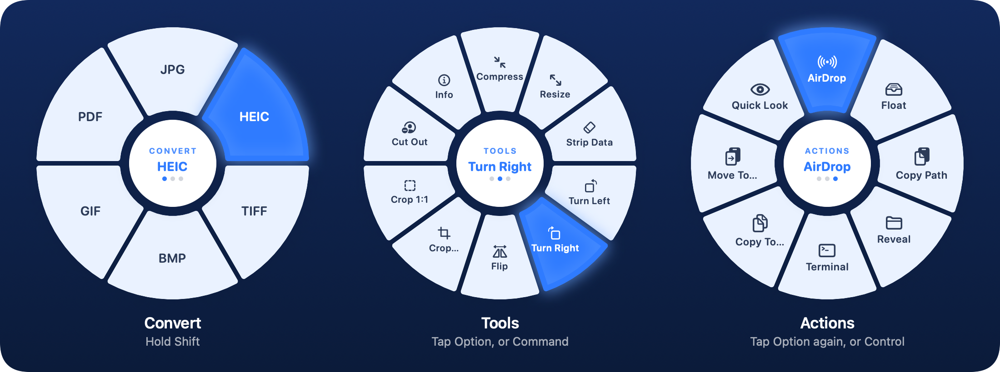

<div align="center">


[](#install)
[](#build-from-source)
[](#privacy)
[](LICENSE)

**[Download](https://github.com/atuuuuuuu/Convrt/releases/latest)** · [Features](#features) · [Keys](#keys) · [Command line](#command-line) · [Build](#build-from-source)

</div>

Convrt lives in your menu bar. Start dragging files from anywhere, **hold Shift**, and a wheel opens at the cursor.
Drop on a slice to convert, edit or send the files: HEIC to JPG, MOV to MP4, WAV to MP3, images to PDF, merge PDFs,
strip location data from photos. Results land next to the originals and never overwrite anything.
Everything happens on your Mac: no network, no accounts. An open-source take on
[Tangerine](https://tangerineformac.app/), with more on top.

<div align="center">
  
  <br><sub>Real recording of the app. <a href="https://github.com/atuuuuuuu/Convrt/releases/latest">Download</a></sub>
</div>

<div align="center">
  
</div>

The wheel only shows what fits the files you are dragging: an image gets image formats and image tools, a song gets
audio formats, and so on.

## Install

1. Download `Convrt-macOS.zip` from the [latest release](https://github.com/atuuuuuuu/Convrt/releases/latest).
2. Unzip it and move **Convrt** to Applications.
3. The release is not notarized, so the first time, **right-click Convrt → Open → Open**.
4. Allow **Accessibility** (called **Device Control and Data Access** on macOS 27 and later) and **Input Monitoring** when asked (menu bar icon → *Check Permissions…*), then restart Convrt.
   These let it notice Shift while you drag. If macOS keeps asking, use *Reset Permissions…* in the menu once.
   Rather not grant them? The **Drop Zone** window (menu bar → *Drop Zone…*) gives you the same wheels with no permissions.

Optional: `brew install lame` to make MP3 files (macOS can read MP3 but cannot write it).

## Keys

| While dragging | What happens |
|---|---|
| Hold **Shift** | Open the wheel on **Convert** |
| Tap **Option ⌥** | Switch Convert → Tools → Actions |
| **Command ⌘** / **Control ⌃** | Jump to **Tools** / **Actions** |
| **Scroll**, **Tab**, **arrow keys** | Move the highlight |
| Release on a slice | Run it (release on the centre runs the highlighted slice) |
| **Esc**, or let go of Shift | Close the wheel |

Every key can be turned off in Settings.

## Features

### Convert

| Drag in | Get out |
|---|---|
| **Images:** PNG, JPG, HEIC, TIFF, BMP, GIF | Any of those, or PDF. Several images make one PDF. |
| **PDF** | One image per page |
| **Audio:** WAV, MP3, M4A, FLAC, AIFF | Any of those, e.g. MP3 → WAV, WAV → MP3 |
| **Video:** MOV, MP4, M4V | MOV or MP4, or just the sound (M4A, WAV, MP3) |

### Tools

| For | Tools |
|---|---|
| **Images** | Compress · Resize · Strip Data (removes EXIF and GPS) · Turn Left / Right · Flip · Crop… · Crop 1:1 · Cut Out (background removal) · Merge to PDF |
| **Video** | Mute · Trim… · Snapshot (a still as JPG) · Extract Audio |
| **PDF** | Merge · Split Pages · Get Text |
| **Anything** | Zip · Unzip · Info (size, dimensions, duration, camera…) |

**Crop…** opens an editor: drag the corners or the whole box, pick Free, Original, 1:1, 4:3, 16:9, 3:2 or A4, with a
thirds grid and the live pixel size. Several images are cropped one after another.

### Actions

AirDrop · Float · Copy Path · Reveal in Finder · Open in Terminal · Copy To… · Move To… · Quick Look

### Beyond the wheel

- **Drop Zone** (menu bar → *Drop Zone…*): the same wheels in a window. Works without any permissions.
- **Floating Shelf**: an always-on-top tray for files; drag them back out into any app. Use the *Float* action.
- **Watch Folders** (Settings): files that land in a folder are converted automatically once they finish copying.
  Originals are never deleted.
- **Recent Conversions + Undo**: the menu lists recent results; *Undo* moves them to the Trash.
- **Settings**: trigger key, output folder, quality, resize size, wheel keys, watch folders, launch at login.

## Command line

```bash
Scripts/install_cli.sh                      # installs ~/.local/bin/convrt
convrt convert photo.heic --to jpg
convrt convert song.wav --to mp3 --out ~/Music
convrt tool compress *.jpg
convrt tool trim clip.mov --from 0:05 --to 0:20
convrt formats song.mp3                     # what can this file become?
convrt watch ~/Downloads/Incoming --to pdf
```

Same engine as the app. Exit status: `0` done, `1` some files failed, `2` bad command.

## Privacy

- No network code, no accounts, no analytics.
- Only Accessibility and Input Monitoring are requested, to see Shift during a drag.
- The log (`~/Library/Logs/Convrt.log`) holds counts, never file names.
- Recent Conversions stores output paths on your Mac only
  (`~/Library/Application Support/Convrt/history.json`); *Clear History* empties it.

## Build from source

1. Open `Convrt.xcodeproj` in Xcode 15 or later (macOS 13 target).
2. **Convrt → Signing & Capabilities**: pick your own Team (a free personal team works). A stable signature keeps
   macOS from asking for permissions again after every build.
3. Press **⌘R**.

```bash
Scripts/test.sh                  # app tests via Swift Package Manager (no app launch)
Scripts/test-cli.sh              # command-line tests
Scripts/xb.sh build              # compile check
python3 Scripts/sync_xcode_sources.py   # add new .swift files to the Xcode project
Scripts/render_readme_art.sh     # redraw the README images from the real wheel
```

<details>
<summary>Project layout</summary>

```
Convrt/App      app, settings, permissions, menu bar
Convrt/Wheel    the wheel: events, state, hit testing, drop target
Convrt/Engine   conversion and tools (shared with the CLI)
Convrt/UI       wheel view, cropper, shelf, Drop Zone, settings
CLI/            the convrt command-line tool
ConvrtTests/    unit tests
```

</details>

## Not done yet

Dragging images straight out of a web browser, OGG / WebM / MKV, 7z / RAR, reading text from scanned PDFs, and
trimming audio. Ideas and pull requests are welcome; please run `Scripts/test.sh` first.

## License

[MIT](LICENSE)

If Convrt saves you a few clicks, a ⭐ on the repo helps other Mac users find it.
