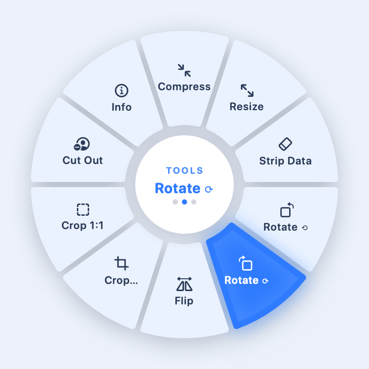

<div align="center">

<picture>
  <source media="(prefers-color-scheme: dark)" srcset="assets/logo-white.png">
  
</picture>

# Convrt

**Drag a file. Hold Shift. Convert it, edit it, or send it.**
An open-source, fully offline file toolkit that lives in your Mac's menu bar.

[](#install)
[](#build-from-source)
[](#privacy)
[](LICENSE)


</div>

---

## What it is

Convrt sits in the menu bar with no Dock icon. Start dragging files from anywhere, **hold Shift**, and a wheel opens at
your cursor. Drop the files on a slice. Results land next to the originals and **never overwrite** anything. An open-source
take on [Tangerine](https://tangerineformac.app/), with more on top. Nothing leaves your Mac.

## The three wheels

<div align="center">
  
  
  
</div>

| While dragging a file | What happens |
|---|---|
| Hold **Shift** | The wheel opens at the cursor on **Convert**. |
| Tap **Option ⌥** (Shift held) | Cycle **Convert → Tools → Actions**. Holding Option and Shift together opens Tools. |
| **Command ⌘** / **Control ⌃** | Jump straight to **Tools** / **Actions**. |
| **Scroll**, **Tab**, **← → ↑ ↓** | Move the highlight around the wheel. |
| Release on a slice | Run it. Release on the centre to run the highlighted slice. |
| **Esc**, or let go of Shift | Close the wheel. |

The wheel only shows what makes sense for what you are dragging. All the keys can be turned off in Settings.

## Features

### Convert
| You drag | You can make |
|---|---|
| Images (PNG, JPG, HEIC, TIFF, BMP, GIF, ...) | PNG, JPG, HEIC, TIFF, BMP, GIF, PDF. Several images become one PDF. |
| PDF | One image per page (PNG, JPG, HEIC, TIFF) |
| Audio (WAV, MP3, M4A, FLAC, AIFF) | Any of those, for example **MP3 → WAV** and **WAV → MP3** |
| Video (MOV, MP4, M4V) | MOV or MP4, or just the sound as M4A, WAV or MP3 |

macOS cannot write MP3 files, so MP3 *output* needs the `lame` encoder: `brew install lame`. Convrt finds it automatically
(or `ffmpeg`), and only offers MP3 when one is installed. Everything else works out of the box.

### Tools
- **Images:** Compress, Resize, Strip Metadata (removes EXIF and GPS), Rotate left/right, Flip, **Crop…**, Crop 1:1, Cut Out (background removal with Apple Vision), Merge to PDF.
- **Interactive cropper:** drag 8 handles or the whole box, pick Free, Original, 1:1, 4:3, 16:9, 3:2 or A4, see a rule-of-thirds grid and the live pixel size. Drop several images and it walks through them.
- **Video:** Mute, Trim… (start and end times), Snapshot (a still as JPG), Extract Audio.
- **PDF:** Merge, Split Pages, Get Text.
- **Anything:** Zip (and Unzip for `.zip` files; archives cannot write outside their folder), Info (size, dimensions, duration, camera, and more).

### Actions
AirDrop, Float (puts files on a floating shelf you can drag out of), Copy Path, Reveal in Finder, Open in Terminal, Copy To…, Move To…, Quick Look.

### Beyond the wheel
- **Drop Zone** (menu bar icon → Drop Zone…): the same wheels in a window. Works even without the drag permissions.
- **Floating Shelf:** a small always-on-top panel that holds files so you can drag them into other apps.
- **Watch Folders** (Settings): new files that land in a folder are converted automatically, once they have finished downloading or copying. Files already there are left alone and originals are never deleted.
- **Recent Conversions + Undo:** the menu bar icon lists recent results. Undo moves them to the Trash. Only paths are stored, on your Mac, in `~/Library/Application Support/Convrt/history.json`. Clear History empties it.
- **Settings:** trigger key, output folder, quality, resize size, compress quality, wheel keys, watch folders, launch at login.

## Command line

```bash
Scripts/install_cli.sh                        # installs ~/.local/bin/convrt
convrt convert photo.heic --to jpg
convrt convert song.wav --to mp3 --out ~/Music
convrt tool compress *.jpg
convrt tool trim clip.mov --from 0:05 --to 0:20
convrt formats song.mp3                       # what can this file become?
convrt watch ~/Downloads/Incoming --to pdf
```

It uses the same engine as the app. Originals are never deleted. Exit status: 0 done, 1 some files failed, 2 bad command.

## Install

Download `Convrt-macOS.zip` from [Releases](https://github.com/atuuuuuuu/Convrt/releases), unzip, and move Convrt to
Applications. Or [build it](#build-from-source).

## Permissions

Convrt needs **Accessibility** and **Input Monitoring** to notice Shift while you drag. Open the menu bar icon → *Check
Permissions…*, switch Convrt on in both lists, and restart it. If macOS keeps asking after you rebuild, the app is not
signed with a stable identity; use **Reset Permissions…** in the menu once. See [SHIPPING.md](SHIPPING.md).

## Build from source

1. Open `Convrt.xcodeproj` in Xcode 15 (deployment target macOS 13).
2. Target **Convrt → Signing & Capabilities**: choose your own Team (a free personal team is fine). Avoid "Sign to Run Locally".
3. Press ⌘R.

New `.swift` files need adding to the project: run `python3 Scripts/sync_xcode_sources.py`.

```bash
Scripts/test.sh        # app logic tests (Swift Package Manager, about 10 s, no app launch)
Scripts/test-cli.sh    # command-line tests
Scripts/xb.sh build    # compile check
```

`xcodebuild test` hangs on a Mac with Developer Mode off, which is why tests run through `swift test`.

## Project layout

```
Convrt/App      app, settings, permissions, menu bar
Convrt/Wheel    the wheel: events, state, hit testing, drop target
Convrt/Engine   conversion and tools (shared with the CLI)
Convrt/UI       wheel view, cropper, shelf, Drop Zone, settings
CLI/            the convrt command-line tool (symlinks the engine)
ConvrtTests/    unit tests
```

## Privacy

No network code, no accounts, no analytics. Only Accessibility and Input Monitoring are requested. The log
(`~/Library/Logs/Convrt.log`) holds counts and states, never file names.

## Not done yet

Dragging an image out of a web browser (needs a download), 7z/RAR/OGG/WebM/MKV, reading text from scanned PDFs.

## Contributing

Issues and pull requests are welcome. Please run `Scripts/test.sh` before sending a change.

## License

[MIT](LICENSE)
